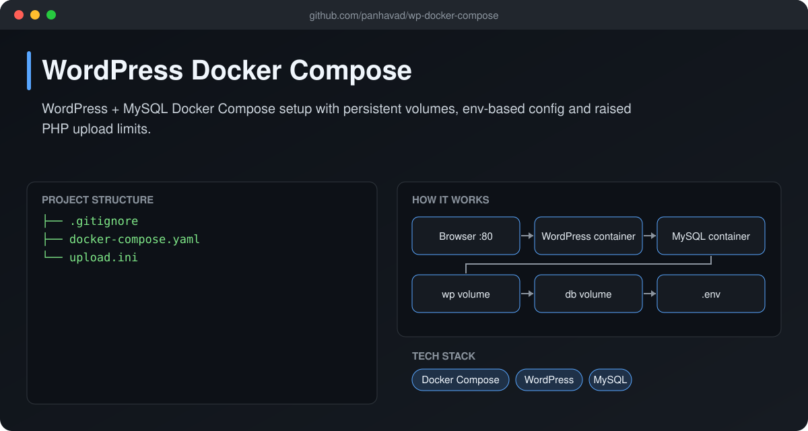
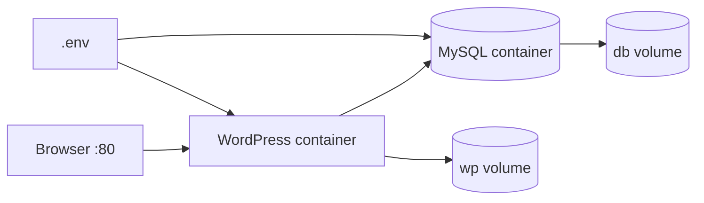

# WordPress Docker Compose

 [](https://github.com/panhavad/wp-docker-compose/releases/latest)

A simple **WordPress + MySQL Docker Compose stack** with persistent volumes, `.env`-based configuration and a custom `upload.ini` for larger media uploads.



## Features

- WordPress and MySQL with selectable tags
- Named volumes for site and database
- Custom PHP upload size via `upload.ini`
- Auto restart

## How it works



## Getting started

```bash
cat > .env <<EOF
WP_TAG=latest
MYSQL_TAG=8
DB_HOST=db
DB_USER=wp
DB_PASSWORD=change-me
DB_NAME=wordpress
EOF
docker compose up -d
```

## Download

Grab the packaged source from the [latest release](https://github.com/panhavad/wp-docker-compose/releases/latest).

## Tech stack

- Docker Compose
- WordPress
- MySQL

## Project structure

```text
wp-docker-compose/
├── docs/
├── .gitignore
├── docker-compose.yaml
├── README.md
└── upload.ini
```
